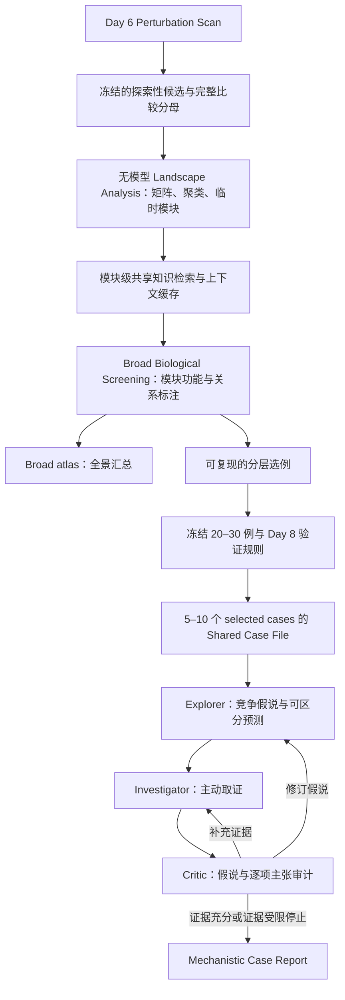

> Historical proposal, superseded by `docs/clue_discovery/JURE_Clue_Discovery_Method.md`. It is not the current architecture.

# Broad Screening → Deep Investigation v0.1

**2026-09-28 更新**：用户将本轮 Broad Screening v0.1 明确为无模型的结构分析与接口完善，实施在 [`broad_screening/`](../../../broad_screening/README.md)，正式产物在 `outputs/broad_screening_v01/` (historical source, not bundled: `../../outputs/broad_screening_v01/LANDSCAPE_REPORT.md`)。以下 biological screening/选例条目仍为后续设计，不是本轮执行范围。三份完整要求归档于 `docs/broad_screening/requirements_*.txt`；最新指令暂缓图表，只保留作图数据。本轮完成后停止，不执行 JEV、GO、文献、Day 8 或三 Agent，也不决定最终病例数量。

日期：2026-09-27。最新顺序：**无模型 Landscape Analysis → module-level Biological Screening → 冻结 20–30 例的 Day 8 validation → 5–10 个 selected Deep cases**。Landscape 已实现于 `landscape_analysis/`，结果见 Landscape 报告 (historical source, not bundled: `../../outputs/broad_screening_v01_landscape_20260927/LANDSCAPE_REPORT.md`)。本文件后续生物注释接口仍为提案，未执行模型调用或自动选例。保留现有三 Agent；不更改 Day 6 冻结扫描协议。

## 1. 三个阶段、两个调查尺度

JURE 先做 Perturbation Scan，再进行广覆盖的 Broad Screening，最后只对选中的少量案例运行 Deep Investigation。Broad 回答候选全景中有哪些功能联系与未解释现象；Deep 回答某个 perturbation 为什么可能改变一个联合检出状态的频率。

Landscape 只使用扫描产物及数值算法，先回答候选共享了哪些响应结构。后续 Broad Interpretation 可采用确定性检索、轻量分类模型和可选的短文本生成器，重点解释模块，不为全部 6,129 条各写一段文字。全部候选及结构特征保留在 atlas；仅选中案例进入三 Agent 闭环。

## 2. 上游观察必须原样保留

统计依据是 [Day 6 执行协议](../../../perturbation_scan/PROTOCOL.md)。主 Catalogue 有 341 个 states、86 个 triplets、57 个 genes；不是对全部可能基因组合的无偏全景。

- `+` / `−` 表示 raw count > 0 / = 0，即检出／未检出，不表示 DE 的上调／下调。
- `delta = perturbation_frequency - matched_nt_frequency`；`delta=0.18` 展示为 **+18 个百分点**，不是相对增加 18%。
- 同一 triplet 的不同 states 共享基因背景且可能互补；Broad 汇总不能把每行当成独立机制或独立生物学重复。
- 当前候选为 `exploratory_perturbation_candidate`。保留 `nt_selection_adjusted=false`、`eligible_as_confirmed_clue=false`、`external_validation_status=not_performed`。Broad annotation 和选例不能改变这些字段。
- `selected_family_holm_exploratory` 是探索性 selected-family Holm adjusted p，不改称 FDR q-value，也不等于机制置信度。
- 联合状态频率变化不自动证明三阶 interaction rewiring、超越 DE 的解释量或因果机制。

正式输入须来自已完成且通过独立核验的运行，入口为 `outputs/perturbation_scan_day6_v01_20260927/remote/outputs/day6_scan/scan/candidates.jsonl`。完整比较表保留 coverage、not-tested 和筛选分母；展示 CSV 或 `first_case.json` 不代替正式输入。

2026-09-27 已归档状态：扫描报告 (historical source, not bundled: `../../outputs/perturbation_scan_day6_v01_20260927/PERTURBATION_SCAN_REPORT.md`)记载 2,034 targets × 341 states = 693,594 个比较，6,129 个探索性候选涉及 419 targets；独立核验记录 (historical source, not bundled: `../../outputs/perturbation_scan_day6_v01_20260927/FINAL_AUDIT.json`)为 passed。Broad annotation、Day 8 验证与真实 Deep 调查均未因此完成。

## 3. Broad 的最小数据契约

以下是拟议接口；上游现有字段与新增字段分开。Broad 数据独立于 Case File，不为每条候选创建 hypotheses 或 EvidenceRecord。

| 层 | 字段 | 来源与要求 |
|---|---|---|
| 原始身份 | `clue_id`, `target`, `reference_id`, `genes`, `states`, `pattern` | 复制 scan candidate；保留 genes/states 顺序 |
| 原始效应 | `perturbation_hits`, `perturbation_n`, `perturbation_frequency`, `matched_nt_frequency`, `delta`, `delta_percentage_points`, `batch_support` | 复制，不让模型重算或改写；匹配 NT 概率不能伪造为 pooled 整数命中比例 |
| 原始统计状态 | `p_value`, `selected_family_holm_exploratory`, `family_size`, `status` 及选择/验证/机制标志 | 按原名保留，同时保留完整 source payload |
| 原始区间 | `nominal_pointwise_delta_ci_low`, `nominal_pointwise_delta_ci_high`, `ci_method` | nominal pointwise Hoeffding 区间；未校正选择/多重性，不是 bootstrap 区间 |
| 来源封装（新增） | `source_run_id`, `source_artifact`, `source_artifact_sha256`, `catalogue_payload_sha256`, `candidate_key`, `cell_context`, `timepoint`, `perturbation_modality` | 从 manifest 与实验 metadata 取得；未知即缺失，不从 gene 名推断。`candidate_key` 由 run identity + clue_id 构成 |
| 检索材料（新增） | `context_refs`, `context_hash`, `retrieval_status`, `retrieval_scope` | 每条含来源版本、文献/数据库定位、原文片段或结构化关系、检索日期、适用物种与细胞背景 |
| 粗注释（新增） | `process_labels`, `relation_status`, `relation_scope`, `directional_support`, `generic_program_flags`, `broad_annotation` | 结构化标签加至多两句解释；每项可指向 context_refs；允许 mixed / unknown / insufficient_context |
| 未确定性（新增） | `abstained`, `abstention_reason`, `model_probabilities`, `model_confidence` | 缺材料、模型弃权、调用失败分别记录；不得把概率解释成机制为真概率 |
| 执行与选例（新增） | `backend_version`, `prompt_hash`, `rubric_version`, `latency_ms`, `token_usage`, `cost`, `selection_tags` | 型号可变别名需记录调用日期及返回版本；费用未知记 null；selection_tags 不等于最终入选 |

`catalogue_payload_sha256` 来自冻结 manifest；它与 scan 中 `catalogue_digest` 的被哈希对象不同，不能直接互换。两者按原语义保存。

`relation_scope` 至少区分 gene_function、target_to_one_gene、target_to_gene_set、signed_joint_state。某个 target 与一个 gene 同属 pathway，只支持局部功能联系，不足以把整个 `A+B-C+` 标为已解释。`directional_support` 单独记录 `supported / contradicted / unresolved`，默认 unresolved。

`relation_status` 建议用 `known / partial / not_found_in_scope / insufficient_context`，避免用“未检索到”宣称“关系不存在”或“发现了新机制”。`generic_program_flags` 是待排查解释，不是已经证明的混杂因素；cell-cycle/stress 案例仍可进入 Deep 对照集。

增加确定性 `target_in_pattern` 标志，记录 target 是否就是被测 pattern gene；这类直接扰动效应单独分层，不自动归为复杂跨基因机制。

## 4. 成本受控的 Broad 流程

1. **确定性整理**：校验来源与候选状态，建立 target、无符号 gene set、带符号 pattern、target × gene set 等索引。atlas 保留所有候选，以及失败/缺失/弃权行。
2. **共享检索**：对唯一 gene、target、gene set 或关系检索键取得限额内的功能与文献材料并缓存。上游只有 57 个 pattern genes，功能材料可复用；target 数量和检索开销另行计算。
3. **带状态的标注**：每条候选使用其真实 target、states、delta、K562/时间/扰动背景及相关材料。复用无符号知识，不复用相反 states 或相反 delta 的解释。
4. **原子判断**：分别判定材料支持的 process、关系范围、常见程序标志和材料充分性；必要时弃权。可选 Jev 或轻量 LLM 只消费这些固定材料，不在此展开机制长链调查。
5. **可选短解释**：用模板或轻量生成器将标签与来源合成一至两句文字。Jev 若采用，只产生预定义判断；不承担自由文本生成。
6. **全景与选例**：输出完整 atlas，再按独立 selection manifest 选少量案例。未入选不删除；选例不影响 Day 6 统计判定。

检索和模型均设置每键/每候选预算、重试上限与运行总预算，执行前写入 manifest。记录 cache hit、失败、实际 token/cost 和 latency；便宜与快速须测量端到端开销，不能只引用模型供应商宣传值。

建议产物：`broad_atlas.jsonl`（完整来源）、`broad_atlas.csv`（人读视图）、`broad_run_manifest.json`、`selection_manifest.json`、`selected_cases.jsonl`。这些名称是拟议产物，当前未生成。

## 5. 分层选例与 Day 8 隔离

用户最新方案取代此前“16 个开发例 + 8 个 Day 8 分层例”的提案：先从 landscape 与 biological screening 冻结 **20–30 个 Day 8 待验证候选**，再从验证结果中选 **5–10 个 Deep cases**。不是模型总分 Top-K，当前尚未执行选例。

| 选例维度 | 待补信息与用途 |
|---|---|
| 效应与 Day 8 可评估性 | 保留强 effect，核实 target、genes、support 与配套 control |
| 特异性与广泛响应 | 同时覆盖特定 perturbation profiles 和共同 response modules |
| 已知与稀少证据 | 生物检索后再区分正对照与 literature-sparse；不能仅凭本轮数值判 novelty |
| 方向 | enrichment 与 depletion 均覆盖 |
| 模块多样性 | 不同稳定结构各取若干，限制同 target/triplet 的重复 |

以上是后续选例维度，不是已选样本或既定 benchmark 结果。维度可重叠，使用多标签存档、唯一 primary stratum 计数；在读取 Day 8 前冻结重叠处理顺序、配额、每 target / triplet 上限、随机种子和层内选择规则。建议在满足规则的层内按固定种子抽样。缺额如实报告，只有预先写明的规则允许补位。

“大效应”和“证据丰富”的阈值、rubric、来源版本及开发/评价划分，应在查看 Deep 结果前冻结。正对照的依据必须先于 Deep 结论存在；没有 signed-state 证据的正对照只能称功能/检索正对照。

**Day 8 的待检验集合与最终 case-study 集合是两回事。** 先冻结 Day 6 待验证 target、genes、states、direction、完整 testing family、Day 8 内 matched NT 与通过/失败/不可评估规则；再访问 Day 8。之后按结果分层抽取 Deep 案例可以用于调查能力评测，但该小样本的复现比例不能估计全候选的复现率。

Day 8 区分 `passed / failed_prespecified_criteria / not_evaluable / not_performed`；目标缺失、缺基因、support 不足属于 not_evaluable。同方向不足以叫通过；未通过也不自动反证 Day 6 机制。若测试 replication 预测能力，锁定并遮蔽 Day 8 结果，不能同时用其标签选例和预测。

## 6. Deep 接口与实验

只有 selected_cases 进入现有 [Shared Case File](../../../jure/casefile/README.md)。Broad 标签是调查上下文/取证线索，不自动成为证据、假说或 Critic verdict。Deep 需要独立检查来源与适用背景。

当前 Case File 仅有 v0.1/v0.2 适配器，尚无本次 batch-matched Day 6 scan adapter。未来 adapter 需保留独立 matched-control estimand、逐 batch counts、Holm 方法及探索性状态；现有 `q_value_shift` 不装入 Holm adjusted p，不能用 pooled NT counts 冒充 matched NT frequency 的分母。`nominal_pointwise_delta_ci_low/high` 与 `ci_method` 必须按原义保存，不映射到 `ShiftEvidence.bootstrap`。先明确兼容表示并做 round-trip 校验，再创建真实 Deep cases。

| 评测层 | 主要比较 | 关键指标与限制 |
|---|---|---|
| Broad | 同一知识材料 + 确定性规则；同材料 + 轻量 LLM；同材料 + Jev | 多标签 process precision/recall、关系范围正确率、带来源 coverage、弃权率、coverage–error 曲线、成本与延迟；概率另评 Brier/ECE，不能假定生物域已校准 |
| 检索/可选表征 | 固定检索 baseline；真实可用的 biological embedding | Recall@K、MRR、known pathway recovery；Jev 若只做 reranking，报告增益来自 reranker，不称 embedding 对比 |
| Deep | 完整三 Agent；去 Critic；固定工具顺序；去 Broad 上下文 | 盲评 hypothesis 可区分性、证据 relevance/directness、逐项主张准确性、routing 与停止合理性、预算及失败原因 |

Broad 评测不能把作为模型输入的 pathway 标签原样当作独立机制真值。明确测的是 annotation lookup 还是 held-out relation recovery；后者应遮蔽目标关系，按 target/相关基因集合划分开发与评价，避免近重复泄漏。公共模型的训练污染无法由这种划分彻底排除，应报告评测范围。

Deep 用同一冻结病例集和预算比较；案例匿名、顺序随机，保留未解决和失败报告。判断 Broad 对 Deep 的贡献时：同病例集的消融衡量上下文价值，匹配预算的选例策略比较衡量 selection 价值，二者分开。

atlas 同时报告 candidate rows、unique targets、triplets、states 的分母；不能以相关行数宣称发现了同样数量的独立机制。当前三 Agent 验收仍主要是 Mock/synthetic，不能把已有执行测试写成真实生物学质量验证。

## 7. 接下来实施的顺序

1. 已完成：核验 Day 6 输入，按 [数值分析协议](../../../landscape_analysis/PROTOCOL.md)生成连续 Δ 矩阵、候选/状态视图、统计分布、临时模块、稳定性与热图。没有生物学命名。
2. 后续再做：以模块为单位冻结最小 annotation rubric 与一小批分层人工标注样本，搭建可追溯的共享检索/cache baseline。
3. 若 JEV 确认为 Typesafe Jev，按 能力核查 (historical source, not bundled: `jev_capability_audit_20260927.md`) 作为可替换分类/reranking backend 试验；没有生物域增益则保留不用。
4. 在相同检索上下文上比较 baseline、轻量 LLM、Jev；通过质量/覆盖/成本验收后将模块注释关联到 candidate atlas，不要求逐条生成解释。
5. 冻结 20–30 例的 Day 8 验证 manifest 与规则；验证后选 5–10 个 Deep cases，完成 scan → Case File 适配，再运行真实 Deep 调查。
