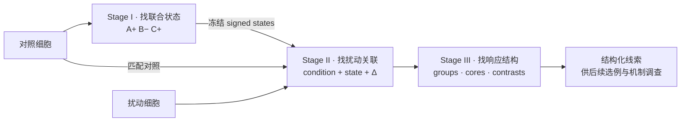

# Clue Discovery：论文可视化与方法定位草案

日期：2026-09-28。本文整理方法图与结果图的叙事，不重跑统计、不修改已有图或冻结结果。当前实现以 [三阶段方法文档](JURE_Clue_Discovery_Method.md) 为准。

## 读者首先需要记住的主线

**找联合状态 → 找扰动引起的状态频率变化 → 找跨扰动的共享响应结构。**

| 阶段 | 核心问题 | 输入与主要输出 | 图中的最小视觉元素 |
|---|---|---|---|
| I Higher-order Reference Discovery | 对照中哪些完整联合状态具有高阶统计支持，并且稳定可测？ | Control cells → frozen signed-state catalogue | 小型 cell × gene 检测矩阵，提取 `A+ B− C+` 等状态条；状态条带锁定标识 |
| II Condition-associated Shift Discovery | 哪些扰动使这些固定状态出现得更多或更少？ | Frozen states + condition/control cells → condition × state effect / exploratory associations | 同一状态在匹配 control 与 perturbation 中的频率对照，用一条 Δ 标出变化 |
| III Broad Response Landscape Organization | 大量关联共享哪些响应，又保留哪些状态差异？ | Continuous signed effects + independent support/selection masks → groups, stable cores, contrasts, structured clues | 聚类矩阵 → stable core/boundary → 具体 condition/state/Δ 的线索卡 |

`+/-` 在三个阶段始终表示检测/未检测，不表示上调/下调。Stage II 的 Δ 是完整状态的 prevalence shift。对照也不能标成“绝对未处理的天然细胞”。

## Figure 1：紧凑方法总览

三列主面板，每列只保留动作、数据对象和输出；正式图内不放完整统计参数清单。



Stage I 下方只加一个小 inset：**低阶依赖引导 + 直接高阶候选通道 → 正式高阶检验**。图中必须画出绕过 pairwise edge 的路径，不能把算法画成“只有显著 A–B 才允许进入 A–B–C”。实际实现还包含固定预算随机探索；细节在 caption 或补充方法中说明。

Stage I 的质量门槛可以用一条短标签：`higher-order support · estimability · held-out validation`。MFI、lower-order Gain、bootstrap、validation-family Holm 的定义放 caption/Methods；MFI 与 Gain 不画成两个相互独立证据投票器。

Stage II 画固定的同一 signed state，而不是在各扰动中重新挑不同 states。Stage III 保留 enrichment 与 depletion，并把稳定核心和边界区分。最终卡片为 `condition + signed state + shift + quality/context`，不能只输出一个抽象 group 名称。

后续 Triage / Deep Investigation 放在 Clue Discovery 外，以一个输出箭头连接。方法图不把 Broad Screening 画成 Agent，也不画已证实的调控边。

## Figure 2：真实数据的发现与组织能力

推荐主图结构为 **全景 + 状态特异性例子 + 跨 gene-set 共同响应例子**，原三张 heatmap 作为这一叙事的基础。

- **A，大面板：连续 signed-effect landscape。** 使用第一张完整热力图的科学内容，明确行是 candidate-bearing perturbations、列是完整 reference states，颜色为 matched Δ。可标出若干已冻结 groups，但不预填 stress/cell-cycle 等功能名。
- **B，状态特异性：同 genes、不同 signed states。** 展示一对 reference 的跨扰动响应散点或对齐小矩阵，证明仅看 gene set 会丢失状态信息。既有例子为 `HIST1H1B− HIST1H1E− HIST1H4C+` 与 `HIST1H1B+ HIST1H1E+ HIST1H4C+`，r≈−0.812；注明互斥状态/频率约束也可产生反向关系。
- **C，跨 gene-set 的 co-response。** 展示 `PCK2+ PHGDH+ TRIB3+` 和 `CEBPB+ DDIT4+ SESN2+` 的完整 effect scatter，r≈0.950，49 个共同 candidate targets。不同基因的状态同步响应，提供共享响应线索；不写成已证实的共同机制。
- **D，可选小面板：模块概览。** 使用第三张模块相关图，或核心/边界摘要；caption 必须说明 activity aggregation。既有第三张图采用标准化均值，后续默认模块 activity 使用中位数，二者不能混用数值或标题。

第二张 candidate-only 热力图与第一张使用相同行列顺序，适合补充图或并列小图。灰色是未选中，不等于 Δ=0；它适合说明筛选后信号的位置，不能单独证明筛选准确。

无需把三张大热力图都放在主图中。三张都来自 Stage III，不足以分别代表三个 Stage 的方法有效性。

## STATOR / mTRIM：继承与改变

这里的 mTRIM 对应此前项目讨论的 Awad & Chen 2014 方法；若“TRAM”另指其他方法，比较需重新核对身份。

| 方法 | 原论文主要对象/任务 | 与 JURE 的关系 |
|---|---|---|
| Stator | 高阶表达依赖和 d-tuples；按细胞中的共现形成可重叠细胞状态，也提供状态富集和跨数据投射 | 借鉴 detected/undetected representation、完整 signed tuples、MFI 思路。不能把这些本身、层次聚类或 reference projection 单独宣称为 JURE 首创 |
| mTRIM | TF binding + expression；推断多 TF 对共同靶模块的协作规则，以 bottom-up 搜索最小显著 TF 组合 | 借鉴组合逐步扩展的搜索思路；不复现其 TF–target 规则、EM 推断或原最小显著组合剪枝语义 |
| JURE Clue Discovery | 冻结 control-derived states → matched perturbation-associated shifts → condition-response landscape → structured cases | 方法贡献应围绕面向扰动线索调查的任务定义、组合设计及验证展开 |

参考：[Stator 正式论文](https://doi.org/10.1038/s44320-024-00074-1)、[Stator 原项目采用的预印本](https://www.biorxiv.org/content/10.1101/2023.12.18.572232v1)、[mTRIM 原论文](https://pmc.ncbi.nlm.nih.gov/articles/PMC4080427/)。项目对照笔记见 方法与数据集 (historical source, not bundled: `../../dataset_audit/methods/Stator_mTRIM_Methods_and_Datasets.md`)。

最值得直接画出的轴变换是：

```text
Stator 的 state grouping：cells × d-tuples 的共现
JURE 的 response grouping：perturbations × signed-state shifts 的共同变化
```

这说明双方 grouping 的观测单位和科学问题不同。Stator 已有状态比较与投射，因此不能把区别简化成“它只描述，我们首次比较条件”。

## 应强调的组合设计，以及需要什么证据

1. **Reference-guided perturbation discovery。** 先在 control 中建立、验证并冻结 reference states，再比较它们的条件频率；以独立的阶段记录 reference evidence 与 shift evidence。仍需明确现有 Stage II 的 reused-control selection 限制，不能声称已解决全部选择性推断问题。
2. **兼顾搜索效率与纯高阶候选。** 依赖引导、固定预算探索以及 v04 的三阶 fingerprint 通道组成候选生成策略。fingerprint 不依赖显著 pairwise edge，但它是偏好强 parity 的启发式，没有完整搜索/通用召回保证。应由 synthetic recovery、预算/资源和通道消融支持其价值。
3. **保留具体 signed state，并以低阶模型为参照检查高阶结构。** lower-order maximum-entropy Gain 与完整状态表 estimability 补充筛选、效应解释和质量控制。既有数学对象的组合不能直接称为新统计量；MFI 与 Gain 也不是独立置信度来源。
4. **在扰动响应空间组织调查线索。** Broad 把多条关联组织为共享响应、stable core/boundary、signed-state contrast 与 gene-disjoint co-response，保留原案例和样本量上下文，再交给 Triage/Deep。热力图展示结构；signed-state 消融和稳定性结果支持组织表示的价值。

这里列出的是已实现的设计与可主张的研究方向。是否足以称为新算法贡献、以及相对原方法的提升幅度，还需要针对同一任务的比较或消融；不能从三张热力图直接推出优于 Stator/mTRIM。

## 结果图与效果验证图的分工

- **真实数据发现图**：展示找到的 states、perturbation shifts 和 shared response structure。
- **方法验证图**：known-truth synthetic recovery、independent/pairwise-only 阴性对照、候选搜索通道消融、signed-state vs gene-only 表示比较、成本与稳定性。

原论文的输出目标并不相同。若直接比较 Stator/mTRIM，先声明共同评测问题与输出转换规则；否则优先对 JURE 各设计做任务一致的消融，不比较不可比的“候选数量”。

建议的一句话论文定位：**面向扰动实验的高阶联合状态线索发现框架，将参考状态识别、条件关联检验和共享响应组织连接起来，为后续机制调查提供可追溯的候选。**

进一步的“继承—增加—动机—问题—验证”对照、matched perturbation estimand 和可用于论文的中英文段落，见 [方法定位与扰动处理](JURE_Clue_Discovery_Positioning.md)。
